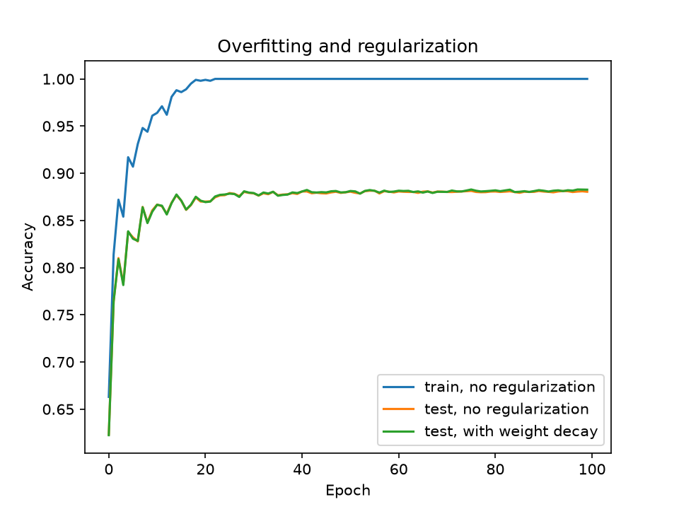

# Digit Recognizer From Scratch

A neural network that looks at a handwritten digit (0 to 9) and predicts which number it is. It is built from scratch in Python and NumPy, with no PyTorch or TensorFlow, so every part of the network is written by hand: the forward pass, the loss, backpropagation, and gradient descent.

This is my project for CP310B - Neural Networks.

## Result

The network reaches **XX.X% accuracy** on the 10,000 MNIST test images, which it never saw during training.

## How it works

1. Each image is 28 by 28 pixels, so it becomes a list of 784 numbers scaled from 0 to 1.
2. The network has two hidden layers (128 and 64 neurons). Each neuron multiplies its inputs by weights, adds them up, and passes the result through an activation function.
3. The output layer has 10 neurons, one for each digit. Softmax turns them into probabilities.
4. Training repeats this loop: make a guess, measure the error with cross-entropy loss, use backpropagation (the chain rule) to find how much each weight caused the error, and use gradient descent to nudge every weight in the direction that lowers it.

## Experiments

**1. Activation functions.** The same network was trained with ReLU, sigmoid, and tanh, and the test accuracy was compared over 10 epochs.


Short summary: XX (for example, which one learned fastest and which ended highest).

**2. Overfitting and weight decay.** The network was trained on only 1,000 images for 100 epochs so it memorizes them. The run was then repeated with weight decay (L2 regularization) turned on.



Short summary: XX (for example, training accuracy reached 100% while test accuracy stalled at XX%, and weight decay raised test accuracy to XX%).

## Live demo

`demo.py` opens a small drawing box. Draw a digit with the mouse, click Predict, and the network shows its top three guesses with percentages.


Tip: MNIST digits are large and centered, so draw big and in the middle of the box.

## Project structure

```
digit-recognizer-from-scratch/
├── README.md
├── requirements.txt
├── digits.py           # network, training loop, and data loading
├── experiments.py      # activation comparison and overfitting experiments
├── demo.py             # drawing box for live predictions
├── digit_weights.npz   # trained weights
└── results/            # plots and screenshots
```

## How to run

Install the libraries:

```
pip install -r requirements.txt
```

Train the network (downloads MNIST on the first run and saves the weights):

```
python digits.py
```

Run the two experiments (saves the plots):

```
python experiments.py
```

Open the drawing demo (needs the trained weights from the first step):

```
python demo.py
```

## Limitations

- The network only knows MNIST-style digits, so messy handwriting or digits drawn small or off-center can fool it.
- It is a plain fully connected network. A convolutional network would likely score higher because it is better suited to images.
- Results can change slightly between runs because the starting weights are random.
