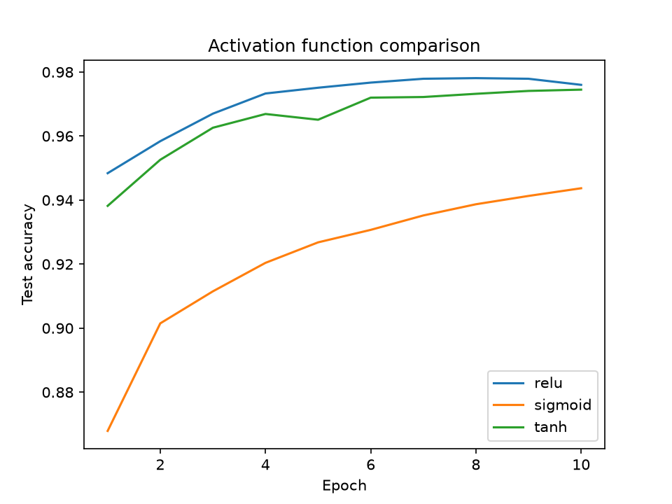
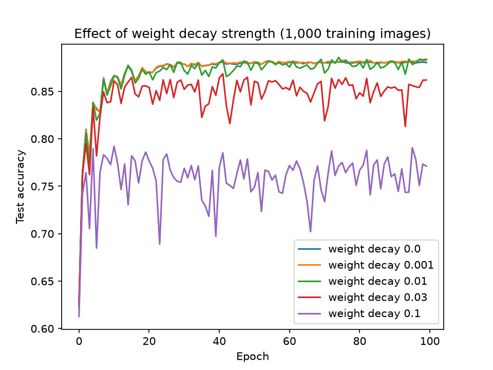
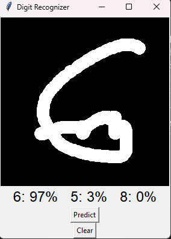

# Digit Recognizer


> **CP310B Neural Networks | Course Project**
> Sarim Siddiqui | Presentation: December 10, 2026

A neural network that looks at a handwritten digit (0 to 9) and predicts which number it is. It is built from scratch in Python and NumPy, with no PyTorch or TensorFlow, so every part of the network is written by hand: the forward pass, the loss, backpropagation, and gradient descent.

## Result

The network reaches **97.60% accuracy** on the 10,000 MNIST test images, which it never saw during training. The best epoch reached 97.81%.

## How it works

1. Each image is 28 by 28 pixels, so it becomes a list of 784 numbers scaled from 0 to 1.
2. The network has two hidden layers (128 and 64 neurons). Each neuron multiplies its inputs by weights, adds them up, and passes the result through an activation function.
3. The output layer has 10 neurons, one for each digit. Softmax turns them into probabilities.
4. Training repeats this loop: make a guess, measure the error with cross-entropy loss, use backpropagation (the chain rule) to find how much each weight caused the error, and use gradient descent to nudge every weight in the direction that lowers it.

Training settings: learning rate 0.1, batch size 64, 10 epochs, weights started with He initialization.

## Experiments

**1. Activation functions.** The same network was trained with ReLU, sigmoid, and tanh, and the test accuracy was compared over 10 epochs.



| Activation | Test accuracy after epoch 1 | Test accuracy after epoch 10 |
|---|---|---|
| ReLU | 94.84% | 97.60% |
| tanh | 93.82% | 97.45% |
| sigmoid | 86.79% | 94.37% |

ReLU learned fastest and finished highest. Sigmoid was still improving at epoch 10, so it learns more slowly rather than being stuck. A likely reason is that sigmoid shrinks the gradients as they travel backward through the layers, while ReLU passes them through.

**2. Overfitting.** The network was trained on only 1,000 images for 100 epochs so it memorizes them.


Training accuracy reached 100% while test accuracy stalled at about 88%, a gap of about 12 points. The same network trained on all 60,000 images reached 97.60%, so more data helped far more than any other change.

**3. Weight decay strength.** The 1,000 image run was repeated with different weight decay (L2 regularization) values.



| Weight decay | Train accuracy | Test accuracy |
|---|---|---|
| 0 (none) | 100.0% | 88.04% |
| 0.001 | 100.0% | 88.26% |
| 0.01 | 99.9% | 88.40% |
| 0.03 | 95.1% | 86.20% |
| 0.1 | 82.9% | 77.13% |

Weight decay helped only a little. The best value, 0.01, gained 0.36 points, which is small enough that it could partly be random noise from a single run. Too much weight decay hurt: at 0.1 the network could not even fit the training data (underfitting).

## Live demo

`demo.py` opens a small drawing box. Draw a digit with the mouse, click Predict, and the network shows its top three guesses with percentages.



The demo prepares your drawing the same way MNIST digits were prepared: it crops to the digit, scales the longest side to 20 pixels, and centers it in a 28 by 28 image. Without this step, my first version of the demo confidently misread clear drawings (a 0 as a 3 and a 7 as a 5) because the plain network is sensitive to the size and position of a digit.

## Project structure

```
Digit-Recognizer/
├── README.md
├── LICENSE
├── requirements.txt
├── digits.py                # network, training loop, and data loading
├── experiments.py           # activation comparison and overfitting experiments
├── weight_decay_sweep.py    # weight decay strength experiment
├── demo.py                  # drawing box for live predictions
├── digit_weights.npz        # trained weights
└── results/                 # plots and screenshots
```

## How to run

Install the libraries:

```
pip install -r requirements.txt
```

Train the network (downloads MNIST into a folder called mnist_data on the first run and saves the weights):

```
python digits.py
```

Run the experiments (saves the plots into the results folder):

```
python experiments.py
python weight_decay_sweep.py
```

Open the drawing demo (needs the trained weights from the first step):

```
python demo.py
```

## Limitations

- The network only knows MNIST-style digits, so messy handwriting can still fool it, and it can be confidently wrong. The percentages come from softmax and show how the network splits its belief, not how likely it is to be correct.
- It is a plain fully connected network. A convolutional network would likely score higher because it handles the size and position of a digit better.
- Each experiment was run once with one random starting point, so small differences (like the weight decay gain) may be noise.

## License

This project is licensed under the MIT License. See the [LICENSE](LICENSE) file for details.
